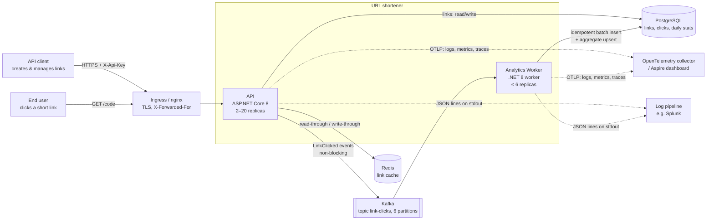
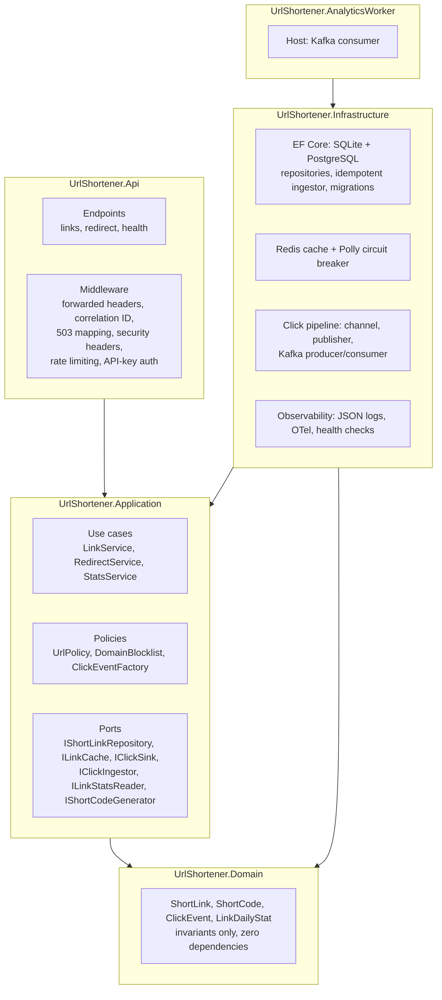

# 04 — Architecture Overview

Components, tools, execution approach, control flow and key decisions. Decisions are recorded as ADRs in
[`adr/`](adr/); requirement decisions (A-1…A-11) live in [01-requirements.md](01-requirements.md).

## 1. System context



**Two runtime modes, one codebase, switched only by environment variables (12-factor):**

| | Zero-setup (`dotnet run`) | Full infrastructure (`docker compose`, Kubernetes) |
|---|---|---|
| Database | SQLite file | PostgreSQL 16 |
| Cache | In-process memory | Redis 7 |
| Click delivery | In-process buffer → DB | In-process buffer → Kafka → Analytics Worker → DB |
| Use | Clone-and-run demo, tests | Production shape, load and chaos tests |

## 2. Components (Clean Architecture)



The dependency rule is **enforced by tests** (`LayerDependencyTests`): Domain references only the BCL; Application
references no EF Core, ASP.NET or Kafka types; Infrastructure keeps implementations `internal` behind ports. The
tests caught two real violations during the project (AI-log entries 24, 32).

| Project | Responsibility | Key types |
|---|---|---|
| Domain | Business invariants: code format, reserved words, expiry, soft delete, UTC normalization | `ShortLink`, `ShortCode`, `ClickEvent` |
| Application | Use cases and policies, expressed against ports; expected failures as `Result<T>` | `LinkService`, `RedirectService`, `UrlPolicy`, `DomainBlocklist` |
| Infrastructure | Adapters: persistence, cache, messaging, telemetry, health | `ShortLinkRepository`, `EfClickIngestor`, `DistributedLinkCache`, `ClickPublisherService`, `KafkaClickConsumerService` |
| Api | HTTP surface and cross-cutting middleware | `LinkEndpoints`, `RedirectEndpoints`, `ApiKeyAuthenticationHandler`, `RateLimiting` |
| AnalyticsWorker | Separately deployable consumer | `Program` (composition only) |

## 3. Control flow

### 3.1 Redirect: the hot path (read:write ≈ 100:1)

```mermaid
sequenceDiagram
    autonumber
    participant U as User
    participant A as API
    participant C as Redis (breaker)
    participant D as PostgreSQL
    participant B as Click buffer
    U->>A: GET /{code}
    A->>A: rate limit (per real client IP), code well-formed?
    A->>C: get snapshot (≤100 ms, skipped if circuit open)
    alt cache hit
        C-->>A: {target, expiresAt}
    else miss or cache down
        A->>D: SELECT by code (unique index)
        D-->>A: link (or none → 404; DB down → 503 + Retry-After)
        A->>C: set (TTL ≤ min(5 min, expiry))
    end
    A->>A: expired → 410 · blocklisted domain → 410
    A->>B: TryEnqueue(click) — never awaits, never throws
    A-->>U: 302 Location, Cache-Control: no-store
```

Nothing analytics-related is awaited. Before the brownfield refactor, step 9 was an awaited DB insert; an analytics
failure returned 500 and a 10 s analytics lock stalled redirects for 10 s
([scenarios/02-brownfield.md](scenarios/02-brownfield.md)).

### 3.2 Click pipeline (eventually consistent, at-least-once, exact counts)

```mermaid
sequenceDiagram
    autonumber
    participant B as Click buffer (10k, drop-oldest, counted)
    participant P as Publisher (batch 500 / 200 ms)
    participant K as Kafka (key = code)
    participant W as Worker
    participant D as PostgreSQL
    P->>B: drain batch
    P->>K: Produce (non-blocking; acks=all, idempotent producer; client queue rides out outages)
    W->>K: consume batch (manual offsets)
    W->>D: BEGIN; insert clicks with unseen IDs; upsert (code, day) += inserted; COMMIT
    W->>K: commit offsets (only after the DB commit)
    Note over W,D: crash before commit → redelivery → duplicates ignored by ID → totals stay exact
```

Per-code ordering (partition key) serializes aggregate updates for a link without locks. Losses are possible only for
clicks still in API memory at a crash, or when an outage outlasts the buffers; both are counted and logged.

### 3.3 Create

`POST /api/v1/links` → API-key auth (fixed-time compare) → per-key rate limit → `UrlPolicy` (scheme, credentials,
private/loopback/metadata IPs in any notation, self-loop, blocklist, IDN → punycode) → alias lowercased and validated →
`Idempotency-Key` replay check → insert; the **unique index decides** collisions (no check-then-insert) → write-through
to cache → `201` (identical `201` + `Idempotent-Replayed: true` on retries).

## 4. Failure behavior (all verified by chaos tests on real infrastructure)

| Failure | Redirects | Clicks | Operational signal |
|---|---|---|---|
| Analytics table locked 10 s | Unaffected (max 35 ms) | Delayed, none lost | Worker retry logs |
| Kafka down 10 s | Unaffected | Delivered after recovery (0 lost) | Drop warnings only if buffers overflow |
| Redis down 10 s | Served from DB (0 errors) | Unaffected | 3 log lines; readiness Degraded; breaker open/closed |
| PostgreSQL down 10 s | Cached: unaffected · uncached: 503 in 44 ms | Delivered after recovery (0 lost) | Readiness Degraded; throttled 503 log |
| Worker killed mid-batch | Unaffected | Exact (duplicates absorbed) | Consumer lag |
| Client floods / scans codes | 429 + Retry-After | — | — |

## 5. Tools and execution approach

| Concern | Tool / technique |
|---|---|
| Language / runtime | C# 12, .NET 8 LTS, ASP.NET Core Minimal APIs |
| Persistence | EF Core 8 (provider-specific migration sets), PostgreSQL 16, SQLite |
| Messaging | Kafka 3.8 (KRaft), Confluent.Kafka client |
| Cache / resilience | Redis 7 via `IDistributedCache`; Polly v8 circuit breaker |
| Observability | JSON console logs, OpenTelemetry (OTLP), Aspire dashboard locally, `dotnet-counters` for live metrics |
| Testing | xUnit, FluentAssertions 6, `WebApplicationFactory`, FakeTimeProvider; k6 load and chaos tests |
| Quality gates | `scripts/quality-gate.sh` = CI: format, analyzers (warnings as errors), tests, coverage ≥ 80%, NuGet vulnerability audit |
| Delivery | Multi-stage non-root images, docker compose, Kubernetes manifests (kubeconform-validated), GitHub Actions |
| AI assistance | Claude Code (primary), with `CLAUDE.md` / `copilot-instructions.md` as shared custom instructions |

**Engineering workflow (per story):** spec/decision in `docs/` → engineer sign-off for 🔒 items → AI drafts code +
tests within `CLAUDE.md` rules → quality gate → verification beyond unit tests (smoke run, load test, chaos test, spec
audit) → traceability entry (accepted / edited / rejected) → engineer approval → story-scoped commit.

## 6. Key decisions

| ADR | Decision |
|---|---|
| [0001](adr/0001-clean-architecture-dotnet8.md) | Clean Architecture on .NET 8 with enforced layering |
| [0002](adr/0002-random-base62-codes.md) | 7-char CSPRNG Base62 codes; DB unique index decides |
| [0003](adr/0003-302-redirects.md) | 302 + `no-store`, not 301 |
| [0004](adr/0004-event-driven-analytics.md) | Event-driven analytics via buffer → Kafka; transactional outbox rejected for the redirect path |
| [0005](adr/0005-cache-aside-with-breaker.md) | Redis cache-aside with circuit breaker; failures degrade to DB |
| [0006](adr/0006-readiness-degraded-on-shared-db-outage.md) | Readiness = Degraded (not Unhealthy) when the shared DB is down |
| [0007](adr/0007-dependency-policy.md) | Dependency policy: central versions, licence and vulnerability checks |
